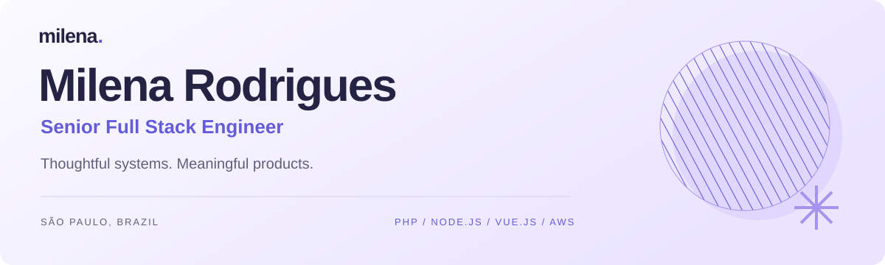
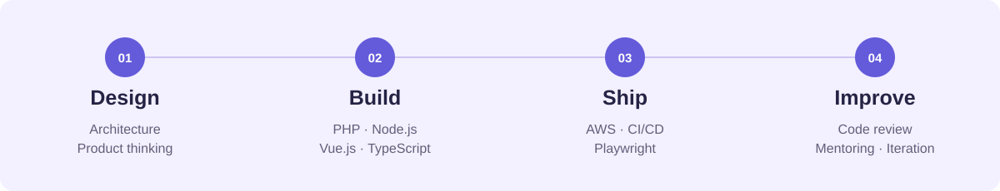

  

  <a href="https://milena-portfolio-self.vercel.app/?lang=en"><strong>Explore my portfolio ↗</strong></a>
  &nbsp; · &nbsp;
  <a href="https://www.linkedin.com/in/milenardsp/">LinkedIn</a>
  &nbsp; · &nbsp;
  <a href="mailto:milenardsp@gmail.com">Let’s talk</a>
  &nbsp; · &nbsp;
  <a href="https://milena-portfolio-self.vercel.app/?lang=pt">Em português</a>

### Hi, I’m Milena 👋

I’m a **Senior Full Stack Engineer at Neon One**, based in São Paulo, Brazil. I build web products end to end, lead engineering teams, and care about the details that make software reliable.

Over **7+ years**, my work has taken me from building an ERP independently to shipping products at Firstbase and evolving ticketing experiences for arts organizations at Neon One.

### From an idea to something people use

| Where I focus | What I work with |
| :--- | :--- |
| **Backend & APIs** | PHP · Laravel · Symfony · Node.js · REST APIs · Event-driven systems |
| **Interfaces** | Vue.js · JavaScript · TypeScript · React for my portfolio |
| **Data & infrastructure** | PostgreSQL · MySQL · MongoDB · Redis · AWS · Docker · Kubernetes |
| **Quality & leadership** | Playwright · Automated testing · CI/CD · Code review · Mentoring |

### A few things I’ve helped ship

**Neon One · Arts People**  
Technical leadership on a ticketing platform serving **900+ arts organizations**. Contributed to the Table Seating release in my first month, own weekly releases, and lead modernization of the patron experience with Node.js and Vue.js.

**Firstbase · Product engineering & technical leadership**  
Coordinated product and engineering for **Firstbase One**, reaching **500+ active customers in six months**. Shipped Mailroom, Agent v2, and Sales Tax, and led and mentored **9+ engineers**.

**[QualEPI](https://github.com/milenarmp/qualepi) · Public project**  
A PHP and JavaScript web application for researching personal protective equipment, with comments and favorites.

→ **[See the products in action](https://milena-portfolio-self.vercel.app/?lang=en#work)** — demos, experience, and more about my work.

---

Good architecture. Thoughtful collaboration. Software that ships.

